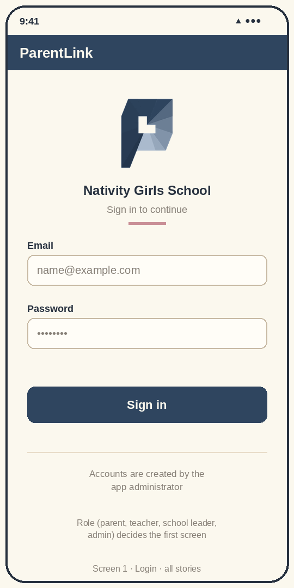
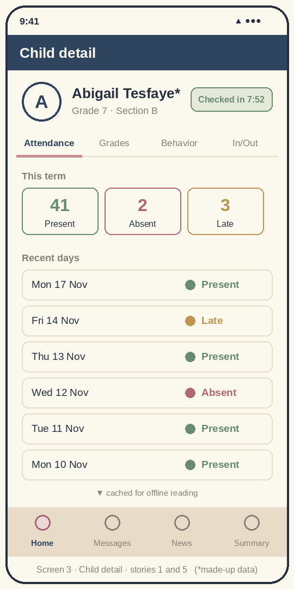
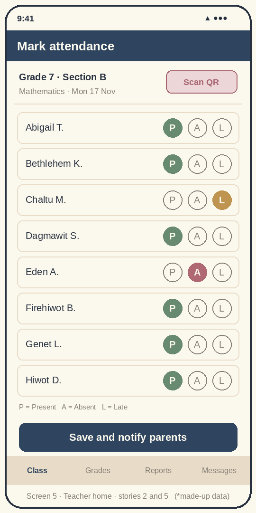
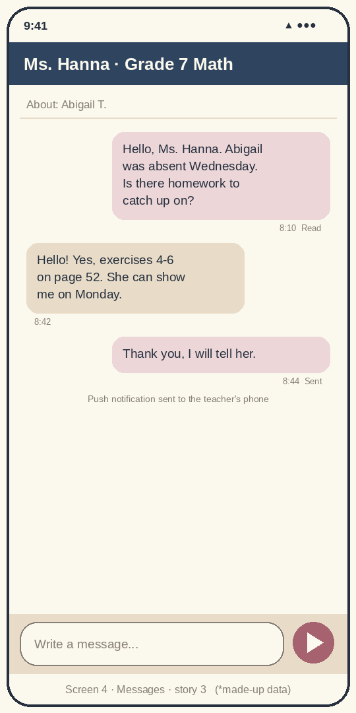

# ParentLink: School-Parent Communication App for Nativity Girls School (NGS)

## 1. Title and one-sentence description

**ParentLink** is an app that helps parents, teachers and administrators at Nativity Girls School (NGS) to share attendance, grades, behavior reports, check-in and check-out times, announcements and the school year schedule, and to message each other, so that parents stay informed about their child without depending on lost letters and scattered channels.

## 2. Group

| Name | Role |
|---|---|
| Wakgari Eshetu | Team lead, Firebase Authentication, Firestore (messaging and announcements, security rules), local database |
| Yeamlak Fiseha | UI/UX, parent, teacher and administrator screens |
| Tamirat Petros | REST API backend (attendance, grades, behavior, check-in/out, student information, user management), push notification sending, AI summary endpoint, hosting |
| Surafel Kassa | QR scanner and term summary screens, AI summary prompt, testing and quality assurance |

## 3. The problem and the real user

NGS parents, teachers and administrators depend on fragmented communication: emails and phone calls, letters sent home with students, meetings, social media (Facebook, Instagram, YouTube and Telegram), a general website, and Google Classroom, which gives parents limited access. Notices are missed or lost, parents must check several places for news, and administrators cannot be sure a notice reached every family.

**Our main user is [FULL NAME], a parent of a Grade [X] student at NGS.** [One or two sentences: a specific time a letter or notice was missed and what it cost them.] **[FULL NAME OF TEACHER]**, who teaches [subject] at NGS, told us [one sentence: a specific delay or access problem]. In our wider surveys, parents preferred mobile app notifications over a website, which needs a steady internet connection, and teachers named delayed responses and limited access to student information as their main challenges.

ParentLink brings these channels into one app. A parent sees each child's records, check-in and check-out times, announcements and schedule in one place. A teacher records attendance, grades and behavior reports in the same app, so parents see them the same day, and either side can send a message instead of a letter or a call. The principal posts announcements once, and every parent gets a push notification. A mobile app fits better than the web version because the phone is always with parents: it delivers notifications immediately, scans QR codes with its camera, and keeps recent records available offline. We will reuse the REST API of our earlier web prototype (Node.js, Express and MySQL).

## 4. Users

- **Parent.** Has one or more children at NGS and wants to follow each without visiting the school. Opens the app every day or two.
- **Teacher.** Marks attendance, records grades, files behavior reports, scans check-in/out and answers parents' messages. Uses the app every school day.
- **School leader** (principal or school admin). Needs a school-wide view and reports by grade, section and teacher, and posts announcements and the school year schedule. Uses the app a few times a week.
- **App administrator.** Someone with technical knowledge of the app, since the principal will not have it. Adds and removes teachers, students and parents (one by one or from a CSV file), links parents to children, and watches crash reports.

## 5. User stories

1. As a parent, I want to log in and see my children's attendance, grades and behavior reports so that I know how each child is doing without visiting the school. (must)
2. As a teacher, I want to record daily attendance, grades and behavior reports for my class so that parents receive accurate, timely information. (must)
3. As a parent, I want to message my child's teacher so that I can ask questions without a phone call. (must)
4. As a school leader, I want to post announcements and the school year schedule so that every parent is notified on their phone. (should)
5. As a teacher or staff member, I want to scan a student's QR code at check-in and check-out so that parents can see when their child arrived and left. (should)
6. As an app administrator, I want to add, remove and import teachers, students and parents and link parents to their children, so that each parent sees only their own children's data. (should)
7. As a school leader, I want to see reports by grade, section and teacher so that I can tell where support is needed. (could)
8. As a parent, I want a short plain-language summary of my child's term so that I understand the numbers at a glance. (could)

## 6. Screens

| # | Screen | Purpose | Stories |
|---|---|---|---|
| 1 | Login | Sign in with email and password | all |
| 2 | Parent home | The parent's children | 1 |
| 3 | Child detail | Tabs: attendance, grades, behavior, check-in/out | 1, 5 |
| 4 | Messages | Thread list and chat | 3 |
| 5 | Teacher home | Class list, mark Present, Absent or Late | 2, 5 |
| 6 | Add grade / behavior report | Forms for a grade or an incident | 2 |
| 7 | Announcements and schedule | Notices and the school year schedule | 4 |
| 8 | Post announcement / schedule | School leader sends a notice or schedule entry | 4 |
| 9 | QR scanner | Camera check-in or check-out | 5 |
| 10 | Manage users | Add or remove users, CSV import, link parents | 6 |
| 11 | School overview | Reports by grade, section and teacher | 7 |
| 12 | Term summary | AI summary of one child's term | 8 |

Sketches of the four most important screens (login, child detail, mark attendance, chat) are in `docs/sketches/`:

| Login | Child detail | Mark attendance | Chat |
|---|---|---|---|
|  |  |  |  |

Dark-mode versions of the same four screens are in `docs/sketches/dark/`. The app palette is charcoal blue, beige, dusty rose and ivory.

## 7. Data model

- **User:** id (Firebase uid), name, email, phone, role (Parent, Teacher, SchoolLeader, AppAdmin)
- **Student:** id, name, grade, section
- **ParentStudent:** parentId, studentId
- **TeacherClass:** teacherId, grade, section, subject
- **Attendance:** id, studentId, date, status (Present, Absent, Late), recordedBy
- **Grade:** id, studentId, subject, score, term, recordedBy
- **BehaviorReport:** id, studentId, category, severity, description, status, reportedBy, createdAt
- **CheckInOut:** id, studentId, type (In, Out), timestamp, recordedBy
- **Announcement:** id, title, message, kind (Meeting, Event, Schedule change), date, createdBy
- **SchoolSchedule:** id, schoolYear, title, startDate, endDate, description, createdBy
- **Thread / Message:** thread id, parentId, teacherId, studentId; message id, senderId, content, isRead, createdAt
- **TermSummary:** studentId, term, text, createdAt

A parent has many children through ParentStudent. Attendance, Grade, BehaviorReport and CheckInOut belong to one Student and name the User who recorded them. Reports by grade, section and teacher are calculated, not stored.

## 8. Data sources

The app is built with Flutter (Dart), Android first, using `firebase_auth`, `cloud_firestore`, `firebase_messaging`, `firebase_crashlytics`, `drift`, `shared_preferences`, `mobile_scanner` and `http`. Data comes from three places:

- **Local persistence.** `drift` (SQLite) caches each child's records and term summary for offline reading. `shared_preferences` stores the selected child, theme and last role. Writes need a connection; an offline write queue is not in scope.
- **REST web service (one we built).** Our Express and MySQL API serves students, attendance, grades, behavior reports, check-in/out records and user management, calculates the school reports, and has a new endpoint for the AI summary. It verifies the Firebase ID token on every request and checks the user's role and parent-student link.
- **Firebase.** Auth handles sign-in, and the app administrator's screen creates and removes accounts through our API. Firestore stores messages, announcements and the school schedule in real time. Cloud Messaging sends push notifications.

**Keeping them consistent.** The parent-student link lives in MySQL, which Firestore rules cannot query. So only our API (using `firebase-admin`) creates a message thread, after confirming the teacher teaches the child's class. The thread lists its two participants, and Firestore rules let only those two read or write it. The API also sends push notifications through `firebase-admin` when an announcement is posted or a grade, behavior report or check-in is recorded, so we do not need paid Cloud Functions.

## 9. Device feature and AI feature

**Device feature: camera (story 5).** A teacher or staff member scans the QR code on a student's ID card to record check-in or check-out. The record (time and staff name) appears on the child's detail screen for the parent. If a code is unreadable, the staff member picks the student from a list. The app asks only for the **camera** permission, when the scanner is first opened, and does not save photos or video.

**AI feature: term summary (story 8).** The parent taps "Summarize" and receives a short plain-language paragraph on one child's term: attendance, strongest and weakest subjects, and any behavior concerns. Our backend sends only numbers and categories (attendance counts, subject scores, behavior category and severity) to a hosted language model API (Claude or Gemini), with no name, no ID and no free-text descriptions, because teachers may type names there. The API key stays on the server, and each summary is saved on the phone. It is labeled as AI-generated and does not replace the school's official reports.

## 10. Risks

| Risk | Likelihood | Plan |
|---|---|---|
| Exams, and too many features for four people in 14 weeks; UI work falls mostly on one person | High | Build stories 1 to 3 first; Surafel builds the QR and term summary screens. If we fall behind, stories 8 and 7 are dropped first |
| Our REST API and MySQL database have no public hosting | Medium | Choose a host that provides MySQL and deploy before Milestone 2; keep a local copy for demos |
| The AI API costs money or is unavailable | Medium | Use a free tier and cache each summary; if the call fails, show a template-based summary from the same numbers |
| Student data or messages are exposed or mixed up between parents | Medium | Check role and parent-student link on the server for every request; create threads only through the API, restricted to two participants; use only made-up test data |
| The app fails on real phones: notifications are not delivered, or crashes go unnoticed | Medium | Test on real Android phones (iOS is a stretch goal: it needs a Mac and a paid developer account); list every announcement inside the app; use Crashlytics |

## 11. Milestone plan

- **Milestone 1 (week 6):** Screens 1 to 6, covering the "must" stories 1 to 3, with navigation and in-memory state, using made-up data. Firebase project and REST API running.
- **Milestone 2 (week 10):** Real data. Stories 1 to 5 complete: Firebase Auth login, REST records, Firestore chat, announcements and schedule (screens 7, 8) with push notifications, QR scanning (screen 9) and `drift` caching. Accounts are created by script until story 6 is finished.
- **Final submission (week 14):** Story 6 (screen 10) complete. Stories 7 and 8 (screens 11 and 12) if time allows. Crashlytics, error handling, tests, README and demo.

## 12. AI-use plan

We plan to use Claude for learning Flutter, Firebase and `drift`, generating boilerplate, reviewing code and suggesting test cases. We used Claude to help draft and edit this proposal. We will not submit AI-generated code we cannot explain, we will note significant AI use in pull requests, and we will follow `../syllabus/policies.md`.
